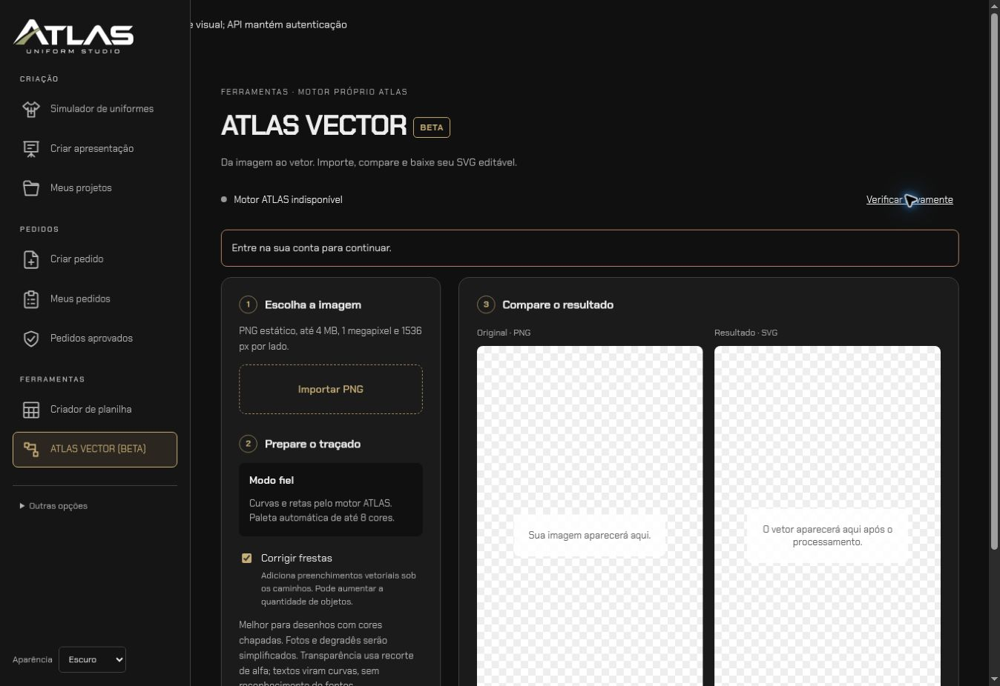

# ATLAS VECTOR (BETA) — revisão, segurança e release

Preparado em 29/10/2026. Andrei Raimundi, direitos reservados; sem licença pública.

## Entrega e isolamento

Base GitHub do Studio:`3b2d6ae731ace5d8a239fba684c4f4f88a6a7549`.
Fonte correspondente:`b44385a3468010e00d992e12d4d2b418436eba0c`.
Motor:`5ebaf0ddceb8d5492d372737056a0edd07dda9f6`.
Branches independentes `feat/atlas-vector-beta`, uma em cada repositório privado.
Não houve alteração de main, variáveis de produção, audiência ou deploy.

Ferramentas → Criador de planilha → ATLAS VECTOR (BETA).
Rota `/ferramentas/atlas-vector`, autenticação `requireChatGPTUser`.
GET/POST `/api/atlas-vector` exigem `account()`; POST valida origem e corpo limitado.
Não usa dados de pedidos, projetos, clientes, listas ou simulador, não salva
resultados, não cria tabelas, não faz alterações em R2. Snapshots HTML do menu
foram sincronizados pelo script existente, sem mudar o comportamento dos módulos.

Fluxo:PNG local → modo fiel e correção opcional de frestas → motor ATLAS →
comparação lado a lado → download SVG. Selecionar outro arquivo ou mudar a
correção descarta o resultado anterior. Cancelar/limpar aborta o fetch e invalida
respostas antigas. Object URLs revogadas na troca e desmontagem.

## Configuração de backend

O Python roda separadamente. Workers não executam Python nem subprocessos.
Gateway tem feature flag fechada por padrão e consulta saúde real do motor.
Indisponibilidade nunca gera saída simulada nem libera o botão de conversão.

| Variável de servidor | Uso |
|---|---|
| `ATLAS_VECTOR_ENABLED` | Somente valor exato `true` permite chamadas |
| `ATLAS_VECTOR_URL` | Origem HTTPS fixa, sem usuário/senha, caminho, query ou fragmento |
| `ATLAS_VECTOR_TOKEN` | Segredo compartilhado >=32 caracteres; armazenar como secret |

Nunca usar `NEXT_PUBLIC_` nem colocar segredo no código. O cliente envia apenas
PNG e `X-Atlas-Gap-Repair`; o gateway descarta os demais headers de entrada.
Destino definido pelo operador, nunca pelo usuário; redirects de fetch rejeitados.
GET de saúde tem timeout3 s e corpo2KiB; upload10 s e4 MiB; conversão35 s e8 MiB,
incluindo leitura da resposta; cancelamento propagado. SVG reconstrói somente
paths com preenchimento explícito e raiz numérica segura, sem entidade/DTD,
eventos, HTML, raster, rede, links, estilos, transformações ou grupos bloqueados.
Download attachment, no-store, nosniff e CSP sandbox. Prévia via img/objectURL.

O serviço Python verifica PNG completo; validação IHDR no gateway é apenas a
primeira barreira, não substitui decode seguro. Limites, Docker e contrato
HTTP implementado estão em `Atlas-Vector/docs/ATLAS_VECTOR_BETA.md`.

## Escopo do pacote recebido

Somente os dois arquivos Markdown anexados foram recebidos. Não vieram o ZIP,
documentos01–06, OpenAPI, patch e manifesto listados neles. Cópias exatas dos dois
anexos ficam em `docs/atlas-vector-handoff/`. Não alegamos ter lido arquivos ausentes.
Contrato HTTP síncrono binário foi implementado e testado conforme orientações
disponíveis. PNG apenas; JPEG/WEBP e outros modos permanecem fora da interface.

## Evidências executadas

- Serviço Python:22 testes passaram, incluindo testes existentes, paleta genérica,
  vazios transparentes, fresta sintética, auth, limites, SVGs maliciosos,
  concorrência, timeout, morte do processo e limpeza de temporários.
- Teste cruzado real:gateway→HTTP local→serviço→subprocesso ATLAS→SVG; executado
  com e sem correção. A troca de HTTPS por loopback existe somente no adaptador
  de teste, sem flexibilizar a configuração de produção.
- Gateway/menu:9 testes passaram, incluindo CSRF, feature flag, ausência de URLs
  fornecidas pelo cliente, tipos/tamanhos, saída hostil e wrappers de autenticação.
- Suíte Studio:383 testes,382 aprovados,1 ignorado,0 falhas na primeira execução.
- TypeScript aprovado após corrigir os tipos da resposta JSON.
- Build oficial Sites/Vinext concluído, incluindo rota autenticada e API novas.
  Suíte final repetida após os ajustes: 383 testes, 382 aprovados, 1 ignorado,
  nenhuma falha. TypeScript final sem erros.
- Navegador local:rota real redireciona para login; componente testado em rota
  temporária de QA, removida antes da entrega. Importação PNG próprio, limpeza,
  correção e temas claro/escuro verificados. Conversão permaneceu desabilitada
  sem autenticação. Corrigidos conflito de coluna com sidebar fixa e CSS inválido.

Os testes não equivalem a auditoria completa de segurança, revisão de Corel ou
garantia sobre imagens arbitrárias. Fixtures geométricas próprias geradas em
runtime, sem logotipos de clubes, imagens de clientes ou segredos no Git.

## Bloqueadores de release e próximos passos

Não foi fornecido nem confirmado endpoint Python externo utilizável. Portanto,
**a conversão web na hospedagem de destino ainda não está concluída/validada**.
Nenhuma produção deve ser ativada apenas porque o teste local passou.

1. Revisar PRs e os dois anexos disponíveis; fornecer documentos ausentes se houver
   requisitos adicionais ao handoff recebido.
2. Implantar container privado em staging, configurar limites e TLS, segredo e
   política de proxy/rede conforme documentação do motor.
3. Configurar as três variáveis apenas em staging; testar sessão autenticada,
   PNG real, comparação, download e abertura como paths editáveis no editor alvo.
4. Validar versões/scan de dependências e imagem de container na infraestrutura.
   Build de Docker e execução no host de destino não foram feitos aqui.
5. Revisão/aprovação de release antes de merge e publicação. Preservar audiência
   existente; não alterar compartilhamento como parte deste módulo.

Rollback:desativar `ATLAS_VECTOR_ENABLED`, reverter PR do Studio separadamente,
parar/reverter container do motor. Não há migrações ou dados a restaurar.
